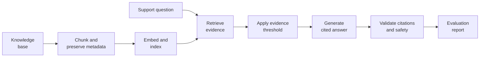

# RAG Pipeline Project

Use this repository as a **template** for your RAG pipeline project. You will build an assistant for the fictional Northstar learning platform support team: search the supplied operational knowledge base, produce cited answers only when evidence supports them, and document where retrieval or generation still fails. Create pull requests in your own copy even if you are working alone, and use them to track your progress.

This assignment follows the earlier lessons on retrieval-augmented generation (RAG), vector similarity search, and retrieval evaluation. Unlike the lesson repository, this project asks you to make and justify system decisions in a complete application.

## Learning Objectives

By the end of this repository, you should be able to:

- Build an end-to-end RAG system that retrieves relevant context and generates accurate, cited answers.
- Evaluate retrieval with `recall@k` and generation quality with answer relevance and faithfulness checks.
- Produce an evaluation report documenting retrieval failures, threshold decisions, and evidence-based improvement recommendations.

## Learning Path



| File / Folder | Description |
|---|---|
| [**Project Description**](project-description.md) | The assignment tasks, suggested workflow, repository layout, and acceptance checklist. |

### Additional Folders and Files

| File / Folder | Description |
|---|---|
| [**data/knowledge_base/**](data/knowledge_base/) | Source documents that your pipeline must index. |
| [**data/evaluation/**](data/evaluation/) | Separate calibration and final evaluation questions. |
| [**solution/**](solution/README.md) | A separate, runnable reference implementation. |
| [**.env.example**](.env.example) | Default configuration and optional provider API key placeholders. |
| [**pyproject.toml**](pyproject.toml) | Project configuration and dependencies. |
| [**uv.lock**](uv.lock) | Dependency lock file. |

## Setup

> [!NOTE]
> Throughout these steps, text in angle brackets like `<repo-name>` is a **placeholder**. Replace it, including the `< >` brackets, with your own value. For example, `cd <repo-name>` becomes `cd mle-rag-pipeline-project`.

### 1. Create the Repository from the Template

Click **Use this template** on GitHub.

When creating the repository:

- Set yourself as the **Owner**
- Choose a repository name
- Disable **Include all branches**
- Click **Create repository**

> [!IMPORTANT]
> If you are working in pairs or groups, only **one person** should complete this step.

---

### 2. Add Collaborators (Pairs/Groups Only)

If working with teammates:

1. Open the repository on GitHub
2. Go to **Settings → Collaborators**
3. Add your teammates as collaborators
4. Share the repository link with your team

Teammates should accept the invitation before continuing.

---

### 3. Clone the Repository

Copy the SSH URL from the **Code** button on GitHub, then run:

```bash
git clone <copied-ssh-url>
```

The copied SSH URL will look like `git@github.com:<your-username>/<repo-name>.git`.

---

### 4. Move into the Project Folder and Install Dependencies

This project uses Python 3.13. The command below installs all dependencies and creates a virtual environment in `.venv/`.

```bash
cd <repo-name>
uv sync
```

The project and `solution/` share this environment. Do not create another environment inside `solution/`.

---

### 5. Create the Environment File

Copy the template once:

```bash
cp .env.example .env
```

Leave provider API keys empty to use the deterministic extractive baseline. For optional live generation, add a [Groq](https://console.groq.com/docs/openai) API key, or set `LLM_PROVIDER=mistral` and add a [Mistral](https://docs.mistral.ai/capabilities/completion/) API key. Provider calls may incur usage costs.

> [!CAUTION]
> Never commit `.env`. It is git-ignored because environment files often hold secrets. Only `.env.example`, with placeholder or default values, belongs in the repository.

---

### 6. Open the Repository in VS Code

> [!NOTE]
> Make sure you open VS Code from the project root so it automatically detects the environment created by `uv sync`.

Launch VS Code in the project root folder:

```bash
code .
```

If you create a notebook to explore the data, select the Python environment created by `uv sync` as the kernel.

## Reference Solution

This repository includes a complete local reference implementation in [solution/](solution/).
Use it to compare implementation choices and expected outputs. It is one way to solve the project, not the required structure for yours.

See [solution/README.md](solution/README.md) for how to run it and how its files fit together.

The reference uses Sentence Transformers and Qdrant local mode. The first semantic run downloads MiniLM; later runs can reuse its Hugging Face cache. The model revision is pinned and runs on CPU. Qdrant local mode needs neither Docker nor an account.

## References & Further Reading

- [Retrieval-Augmented Generation for Knowledge-Intensive NLP Tasks](https://arxiv.org/abs/2005.11401) - Lewis et al., 2020
- [Sentence-BERT: Sentence Embeddings using Siamese BERT-Networks](https://arxiv.org/abs/1908.10084) - Reimers and Gurevych, 2019
- [OWASP LLM Prompt Injection Prevention Cheat Sheet](https://cheatsheetseries.owasp.org/cheatsheets/LLM_Prompt_Injection_Prevention_Cheat_Sheet.html)
- [Sentence Transformers Semantic Search](https://www.sbert.net/examples/sentence_transformer/applications/semantic-search/README.html)
- [Qdrant Local Quickstart](https://qdrant.tech/documentation/quickstart/)
- [Ragas metrics](https://docs.ragas.io/en/stable/concepts/metrics/available_metrics/) and [TruLens RAG triad](https://www.trulens.org/getting_started/core_concepts/rag_triad/) for extending evaluation beyond the supplied baseline.
