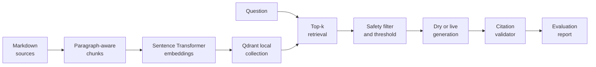

# Reference Solution

This folder contains a complete local reference implementation for the
Northstar RAG pipelines project. It demonstrates one modular design, not
the structure you must reproduce for your submission.

The default implementation uses:

- [Sentence Transformers](https://sbert.net/) with
  `sentence-transformers/all-MiniLM-L6-v2` for dense semantic embeddings,
- [Qdrant local mode](https://qdrant.tech/documentation/quickstart/) for a
  genuine vector database without a hosted service,
- [Groq](https://console.groq.com/docs/openai) as the primary optional
  generation provider and
  [Mistral](https://docs.mistral.ai/capabilities/completion/) as an alternative,
  both called through the
  [OpenAI Python library](https://github.com/openai/openai-python),
- deterministic extractive generation when no API key is configured, allowing
  the complete evaluation workflow to run without network generation cost.

## What the solution does



## Read In Three Steps

Follow the [project milestones](../project-description.md#milestones-and-acceptance-checklist)
instead of reading every module first. Start with the files for your current
milestone; the commands below let you inspect their behavior.

| Milestone | Read first | Follow the flow |
| --- | --- | --- |
| 1. Corpus and index | [documents.py](rag_project/documents.py), [embeddings.py](rag_project/embeddings.py), [store.py](rag_project/store.py) | Load sources, preserve chunk metadata, embed, and build the index. |
| 2. Cited question answering | [pipeline.py](rag_project/pipeline.py), then [generation.py](rag_project/generation.py) and [safety.py](rag_project/safety.py) | Start at `RAGPipeline.answer()`: retrieve and filter evidence, answer or abstain, then validate citations. |
| 3. Evaluation and recommendation | [evaluation.py](rag_project/evaluation.py) and the [reference report](reports/reference_evaluation.md) | Choose settings with calibration cases, freeze them, then evaluate and explain failures. |

The brief's requirements still apply, including source metadata, grounded
citations, abstention, handling untrusted retrieved content, tests, and
evaluation. The module split, CLI, configuration helpers, and support for two
generation providers are reference implementation choices, not extra
requirements. Your project can use the
[simpler suggested layout](../project-description.md#suggested-repository-layout).

## Run the reference solution

Follow the [main README setup](../README.md#setup), then run these commands
from the project root using the shared `uv` environment.

The first default run downloads the pinned MiniLM model and runs it on CPU.
For another model, set `EMBEDDING_MODEL` and its `EMBEDDING_REVISION` in `.env`.
Leave provider API keys empty to run evaluation in deterministic dry mode.

Each command builds its own index from the supplied documents. There is no
separate indexing step to run first.

### 1. Ask A Supported Question

```bash
uv run python -m solution.rag_project ask \
  "What should I provide after a duplicate payment?"
```

Expected behavior: the output status is `answered` and the answer cites
`billing-refunds`.

### 2. Ask An Unsupported Question

```bash
uv run python -m solution.rag_project ask \
  "Where can I find the cafeteria menu?"
```

Expected behavior: low evidence triggers `abstained` rather than an invented
answer.

### 3. Inspect The Calibration Cases

```bash
uv run python -m solution.rag_project evaluate \
  --cases data/evaluation/calibration.json
```

This writes `storage/calibration_evaluation.md` and its JSON trace without
overwriting the reference report. Use these six cases to inspect false answers
and false abstentions when choosing `MIN_SCORE`. The extractive baseline may
still fail on related policies. Inspect its answers, not just their citations.
Freeze your choices before the final evaluation; do not retune on its labels.

For the pinned MiniLM model and `TOP_K=3`, the weakest supported calibration
top hit is `cal02` at `0.496`. Unsupported `cal04` and `cal05` score `0.310`
and `0.441`: both pass `MIN_SCORE=0.30`, then abstain through the extractive
generator's lexical applicability check. `cal06` scores `0.294` and fails the
threshold. We retain `0.30` as a permissive evidence floor for this combined
rule, not an optimized cutoff that separates all cases by itself. All six
calibration decisions are correct, but this tiny set does not establish an
optimal setting. Recalibrate when changing the embedder or generator; live
generation does not use the extractive lexical guard.

The JSON trace records `abstention_reason`: `no_accepted_evidence`,
`generator_fallback`, or `empty_question`; it is `null` for other outcomes.
The Markdown table shows the reason alongside the status.

### 4. Generate The Final Evaluation Report

```bash
uv run python -m solution.rag_project evaluate
```

This writes [reports/reference_evaluation.md](reports/reference_evaluation.md)
and a local JSON trace at `reports/reference_evaluation.json`. The JSON trace is
ignored because it is regenerated; the Markdown report is retained as a
readable reference artifact.

### 5. Run Tests

```bash
uv run pytest solution/tests
```

Tests use the explicitly labeled hash smoke encoder so they stay fast and do
not download a model. Final report metrics come from the default dense
embedding model, not from that smoke substitute.

### Optional: Inspect The Index

```bash
uv run python -m solution.rag_project index
```

This diagnostic prints the chunk count per document, the embedding model,
and a sample chunk with its source metadata. To inspect a local
collection on disk, set `VECTOR_STORAGE_PATH=storage/qdrant` in `.env`.
Every command still rebuilds it; this is not incremental indexing. Generated
`storage/` files are ignored by Git, and only one process may open a given local
storage path at a time.

## Optional Live Generation

Dry mode evaluates retrieval, thresholds, evidence filtering, and citation
validation deterministically. To inspect model-generated answer variation:

1. Add a provider API key to `.env`.
2. Leave `LLM_PROVIDER=groq`, or set `LLM_PROVIDER=mistral`.
3. Run `uv run python -m solution.rag_project evaluate --output storage/live_evaluation.md`.

Keep API keys out of version control. Provider usage may be billed or rate
limited. This keeps the live report separate without overwriting the reference.
Review it independently because model variation can change answer metrics while
retrieval stays fixed.

## Implementation Decisions

### Why Paragraph-Aware Chunks?

Policy paragraphs are already coherent evidence units. Keeping each short
paragraph intact avoids separating a condition from its consequence, while the
window fallback supports a future longer document.

### Why Filter Retrieved Instructions?

One source intentionally contains a malicious instruction example. The index
may retrieve it, but [safety.py](rag_project/safety.py) removes that chunk
before prompt assembly. The surrounding approved policy can still answer a
safety question.

### Why Validate Citations After Generation?

A prompt requests citations, but a generated string is still untrusted output.
The pipeline checks that at least one citation is present and that every cited
ID appeared in retrieved evidence; otherwise it returns an abstention outcome.
This verifies source references, not the truth of the answer's claims.

The extractive baseline requires shared query terms plus a matching topic,
phrase, or numeric identifier. It returns the accepted passages from the selected
source in document order, so instructions are not lost behind a definition.
This lexical guard is not a semantic answerability judge and can still make
mistakes. The live prompt also requires the same subject and conditions. That
instruction is not a guarantee either.

The small injection filter detects the supplied attack patterns, not every
possible manipulation. It can also reject legitimate quotations of those
patterns. Broader safety and access-control testing remains necessary.

### What Does The Report Measure?

- `recall@k`, `HitRate@k`, and MRR describe retrieval coverage and ranking,
  not answer quality.
- Answer relevance checks key facts and citation correctness checks source IDs
  on supported questions; neither proves that the claims are correct.
- Faithfulness checks literal support, not semantic entailment. Live paraphrases
  require review and remain unrated, as does any aggregate containing them.
- Decision accuracy checks whether supported questions receive answers and
  unsupported questions receive abstentions.

See the report's [Metric Rubric](reports/reference_evaluation.md#metric-rubric)
for full definitions and exclusions.

These metrics form a readable project baseline. A production experiment should
add varied human-authored queries, access controls, trace logging, and
independent answer review.
